# MxGantt Demo

> Example Mendix module for the [MxGantt](https://github.com/bharathidas/MxGantt) Gantt chart widget: fifteen working
> examples on one page, over seeded project plans, that show how to set up the widget for editable plans, read-only
> overviews, enterprise planning, resources, costs and a portfolio timeline.

- Mendix Studio Pro 11.12.1 or newer, web only
- MxGantt widget 1.0.0 (bundled in the module package)
- Needs only Atlas Core (`Atlas_Core.Atlas_Default` and `Atlas_Core.PopupLayout`); no Java actions, no jar files, no
  other modules
- License: Apache-2.0

## Installation

1. Download `GanttDemo.mpk` from the [latest release](https://github.com/bharathidas/MxGanttDemo/releases/latest)
   (or the Mendix Marketplace) and import it with **App > Import module package**.
2. The MxGantt widget comes with the package. If your `widgets` folder already has a newer version, keep the newer
   one. Press F4 if the toolbox does not show MxGantt yet.
3. Under **App > Security > User roles**, add `GanttDemo.User` to the roles that should see the page.
4. The page has no URL. Add `GanttDemo.Gantt_Demo` to the navigation (for example a menu item "Gantt chart").
5. Run the app and open the page. Press **Load sample plan**; the examples with their own data have their own button
   (**Add link examples**, **Create 5,000 tasks**, **Load projects sample**, **Load portfolio sample**).

## The examples

All examples are on the page `Gantt_Demo`. Each one is a panel with a short explanation and its own widget settings.

| # | Example | What it shows |
| --- | --- | --- |
| 1 | Project plan you can edit | Drag bars to move a task, drag the ends to change dates and the handle to set progress. Phases fold open and closed, arrows show which task waits for which, and finished tasks are locked. |
| 2 | Read-only overview with the critical path | The same plan by month in the dark theme, with the tasks that decide the go-live date highlighted and a PNG export. |
| 3 | Enterprise planning | Baselines with the slip in days, typed links with lags, working days only (holidays skipped), automatic rescheduling, editing in the task list, undo, bars coloured by assignee and a workload row per person. |
| 4 | Events, hour snapping and saving in a microflow | A click on a bar runs a microflow; moves stay in the browser until a microflow saves them; Delete task appears because a delete action is set; day zoom with hour snapping. |
| 5 | Just the bars | A quarter view without toolbar, task list or arrows, and a workload view where one person may carry two tasks at once. |
| 6 | More link types, lags and assignments | Finish-to-finish and start-to-finish links, lags in hours, days and weeks, a task shared by two people and a zero-length task drawn as a milestone. |
| 7 | Working calendar and auto-scheduling | A four-day week and holidays read from an attribute: non-working days are shaded, durations count working days and Auto-schedule pushes the dependent tasks along. |
| 8 | A plan with 5,000 tasks | Creates 5,000 linked tasks that load 1,000 at a time; only the rows on screen are drawn, so scrolling, filtering and zooming stay fast. |
| 9 | What-if scenarios, status date and export | Plan a scenario and apply or discard it, a status date line that turns late tasks red, a variance column, and export to Excel or MS Project. |
| 10 | Deadlines, total float and the progress line | Deadline flags with warnings, the float each task has before it moves the end of the plan, and a progress line from the status date. |
| 11 | Timeline markers, zoom to fit and project health | Code freeze and go-live markers, Fit to show the whole plan, and a health strip with planned against actual completion, forecast finish and missed deadlines. |
| 12 | Resources, levelling, split tasks and constraints | Two projects sharing five people: load per day against each person's maximum, levelling that removes over-allocation in one undo step, split tasks and date constraints. |
| 13 | Baselines, cost and earned value, portfolio and MS Project | Two named baselines to compare, planned and actual cost with project totals, earned value with an S-curve, and MS Project import. |
| 14 | Your own task list columns: a cost review | Task name first, then exactly the columns the page needs: built-in ones next to plain attributes such as fixed price, actual cost and priority. A row opens the `PlanTask_Details` popup. |
| 15 | Projects timeline: the portfolio at a glance | Twenty-four projects on one multi-year timeline with progress, baseline frame, business need date and red or orange bars from a health attribute. A row opens the `PortfolioProject_Schedule` popup with the project's phases. |

## What is inside

| Document | Purpose |
| --- | --- |
| Entity `ProjectTask` | Tasks of the main example plan: dates, progress, phase, milestone, colour, dependencies, baseline, assignee, status, deadline |
| Entity `GanttContext` | Page helper: new task dates, holidays, status date and the MS Project import |
| Entity `BulkTask` | The 5,000-task plan of Example 8 |
| Entities `PlanProject`, `PlanTask`, `PlanResource` | Two projects with resources, assignments, split tasks, constraints, baselines and cost (Examples 12 to 14) |
| Entities `PortfolioProject`, `PortfolioPhase`, enumeration `ProjectHealth` | The portfolio timeline and its phases (Example 15) |
| Page `Gantt_Demo` | All fifteen examples |
| Pages `PlanTask_Details`, `PortfolioProject_Schedule` | Popups opened from Examples 14 and 15 |
| `DS_GanttContext`, `DS_GanttCalendar`, `DS_GanttStatus` | Data sources for the page helper, the working calendar and the status date |
| `ACT_SeedTasks`, `ACT_SeedLinkExamples`, `ACT_SeedBulkTasks`, `ACT_SeedPortfolio`, `ACT_SeedProjectTimeline` | Create the example data |
| `ACT_AddTask`, `ACT_Feature_Event`, `ACT_Gantt_ImportProject` | Add a task, the event handlers of Example 4 and the MS Project import |
| Module role `User` | Access to the page and the entities |

The source of the module lives in the Mendix model; this repository has the module package (`releases/`), its theme
styles (`themesource/ganttdemo`) and the screenshots (`docs/screenshots`).

## Styles

`themesource/ganttdemo/web/main.scss` carries the page header and panel styles and the purple portfolio colours of
Example 15, so the page looks the same in any app. It uses only the Atlas theme variables.

## Screenshots

| | |
| --- | --- |
| 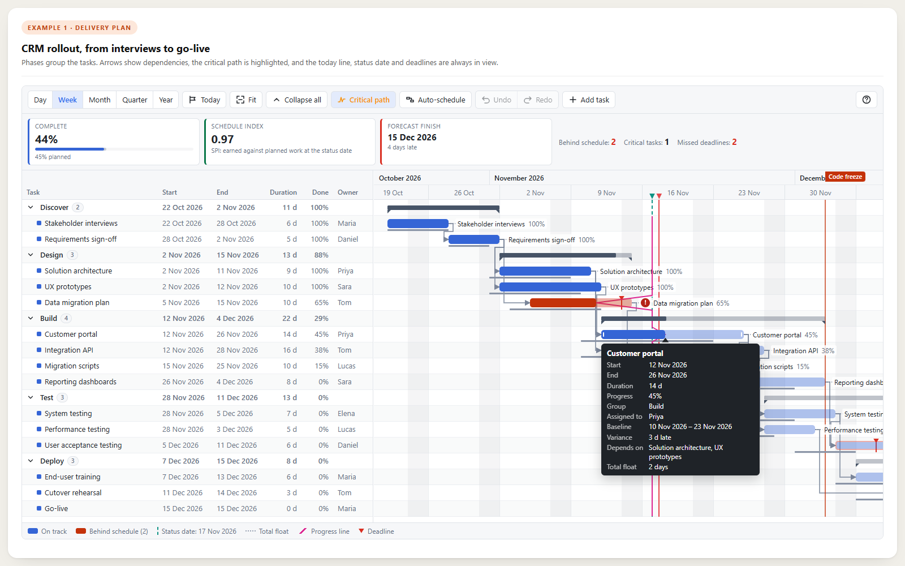 | 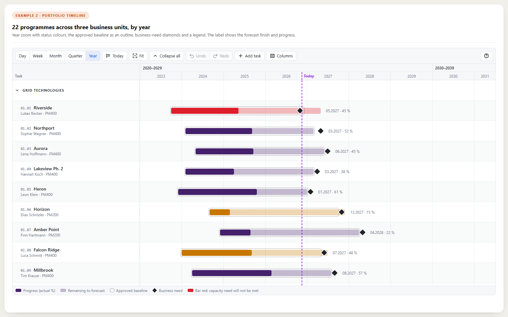 |
| **1. Delivery plan.** Phases, dependency arrows, the critical path, today line, status date, deadlines and a task tooltip. | **2. Portfolio timeline.** Year zoom with status colours, approved baseline outlines, business-need diamonds and a legend. |
| 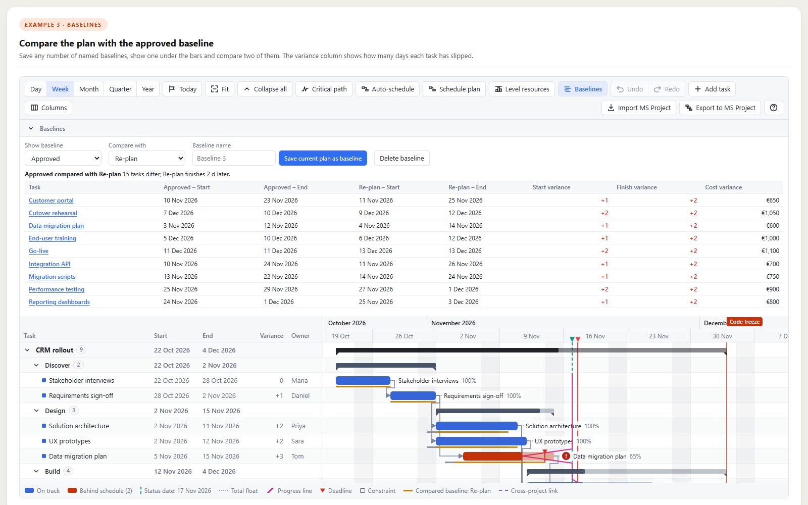 | 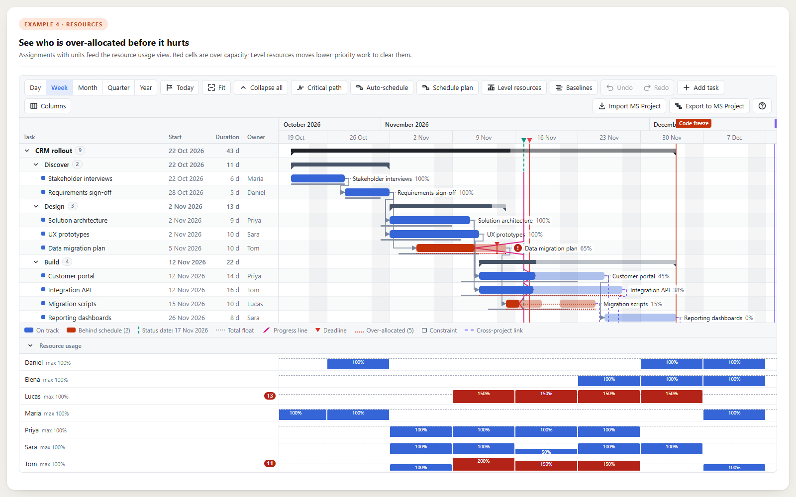 |
| **3. Baselines.** The approved baseline under the bars, compared with a re-plan, with start, finish and cost variance. | **4. Resource usage.** Assignments with units show who is over capacity, next to Level resources. |
| 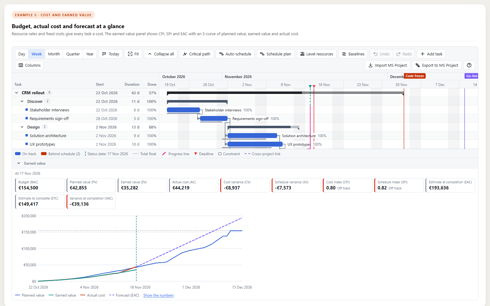 | 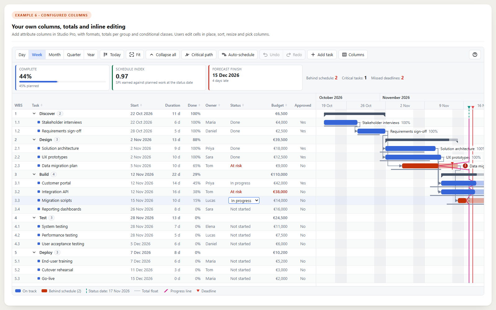 |
| **5. Cost and earned value.** BAC, PV, EV, AC, CPI, SPI and EAC with an S-curve and forecast. | **6. Configured columns.** Owner, Status, Budget with group totals and over-budget highlighting, and inline editing. |
| 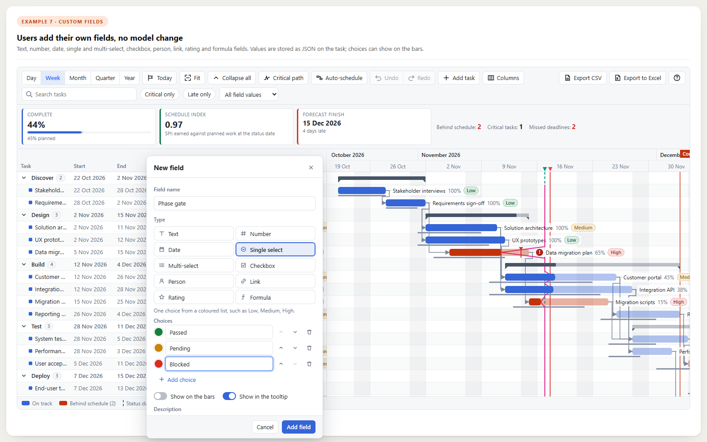 | 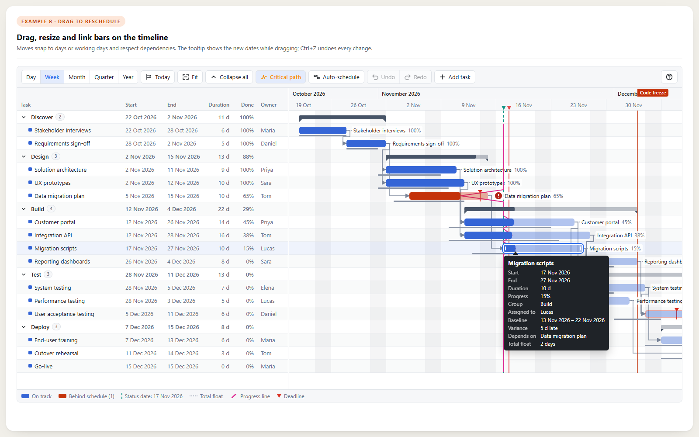 |
| **7. Custom fields.** Users add their own fields, such as a phase gate select with coloured choices. | **8. Drag to reschedule.** A bar mid-drag with the live dates; dependencies and undo are kept. |
| 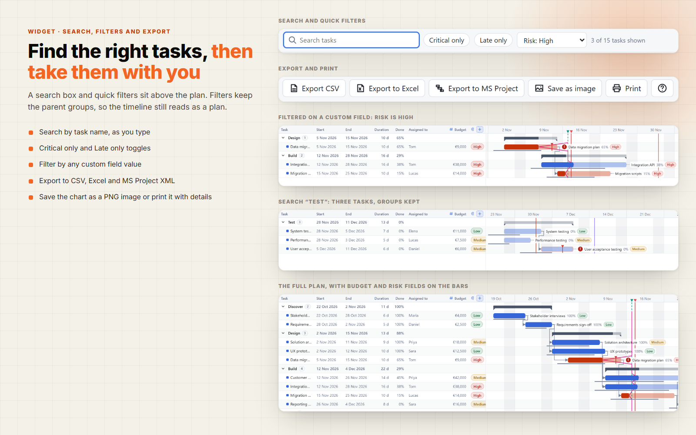 | 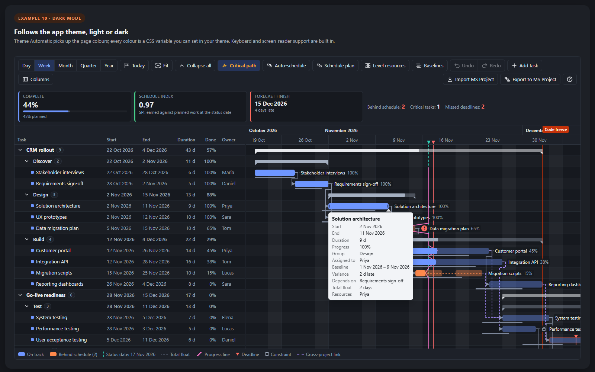 |
| **9. Search, filters and export.** Critical only, Late only, custom field filters, and CSV, Excel and MS Project export. | **10. Dark mode.** The same plan in the dark theme, with cross-project links. |
| 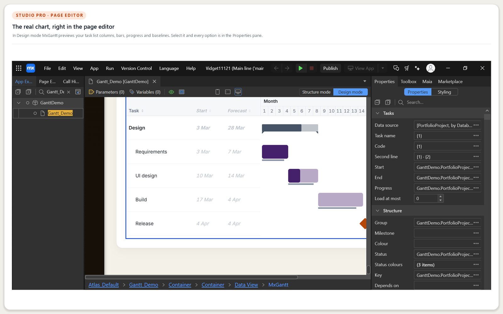 | 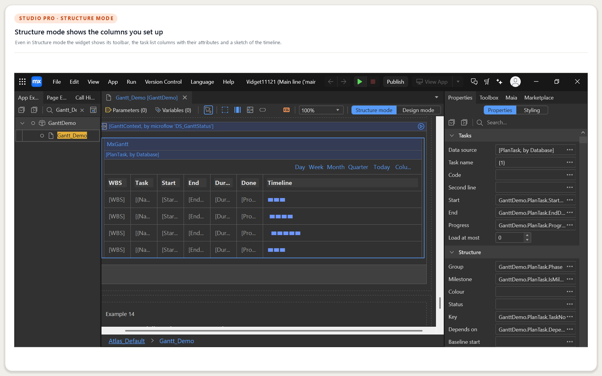 |
| **11. Studio Pro page editor.** Design mode previews the task list columns, bars, progress and baselines. | **12. Studio Pro structure mode.** The structure preview shows the configured columns and a bar sketch. |
| 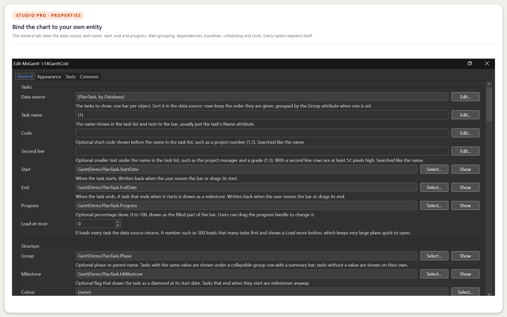 | 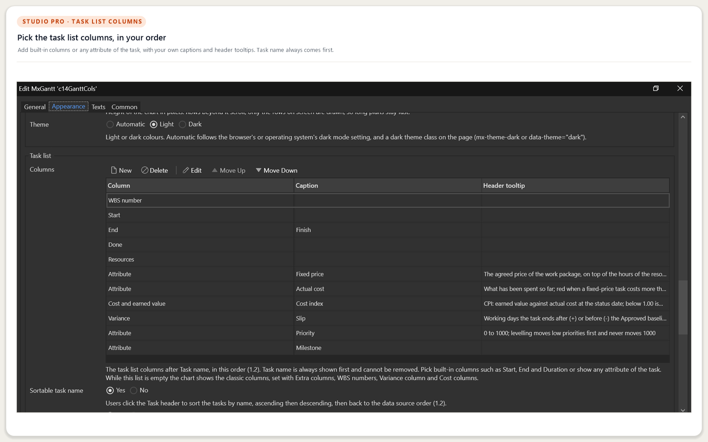 |
| **13. Properties: General.** Data source, task name, code, second line, start, end and progress. | **14. Properties: task list columns.** Built-in and attribute columns with captions and header tooltips. |

## License

Apache-2.0 © MX Techies 2026
